  

  
  
  

## About me

I build things end to end: the website people land on, the account panel behind it, the game server it talks to, and the scripts that keep it all running on a Linux box.

- 🎮 Building **V-Roleplay** end to end: a Turkish MTA:SA roleplay server (~248k lines of Lua) and its web platform
- 🎙️ Working on **Asistan**, a Turkish voice assistant for Windows with a multi-provider AI layer
- 🤖 Running my own bots and automation services on a self-managed VDS
- 🧭 I care about security, honest data (no fake numbers on a dashboard) and tools that are easy to run

## Tech stack

  
   
  

| Area | What I use |
| --- | --- |
| **Frontend** | Astro, TypeScript, React, HTML/CSS |
| **Backend** | Laravel, PHP 8, Python (Flask), Node.js, REST APIs |
| **Data** | MariaDB / MySQL |
| **Game dev** | MTA:SA Lua resources (server and client), binary game protocols, C# |
| **AI** | LLM routing across providers, voice pipelines |
| **Ops** | Linux VDS, shell and PowerShell automation, GitHub Actions, git-crypt |

## Featured work

<table>
  <tr>
    <td width="50%" valign="top">
      <h3>🎮 V-Roleplay Game Server</h3>
      
The full server codebase of a Turkish MTA:SA text roleplay server, written and rewritten by me.

      
<b>185 resources · ~1,100 Lua files · ~248k lines.</b> Accounts, factions, banking, businesses, property, vehicles (fuel, tax, plates, tuning), items and inventory, phone, prison, payday, anti-cheat, logs, Discord integration and a full DX interface layer.

      

        
        
        
      

      🔒 private repository
    </td>
    <td width="50%" valign="top">
      <h3>🏙️ V-Roleplay Web</h3>
      
Official website for the same server: a fast, SEO-friendly landing site, a player account panel and live city data pulled from the game database.

      
Sign-up with e-mail verification and 2FA, game-account linking, characters, admin panel, live economy and leaderboards.

      

        
        
        
        
      

      🔒 private repository
    </td>
  </tr>
  <tr>
    <td width="50%" valign="top">
      <h3>🎙️ Asistan</h3>
      
A personal, Turkish-language voice assistant for Windows, designed around safety from day one.

      
Multi-process design (watchdog, core, executor, voice), an AI router with a quota ledger and a privacy gate, validated and reversible settings, masked action logs and a global emergency-stop hotkey.

      

        
        
        
      

      🔒 private repository
    </td>
    <td width="50%" valign="top">
      <h3>🔌 Game Protocol &amp; Marketplace Tools</h3>
      
A clientless multi-bot manager that speaks a game's binary protocol directly over TCP, an in-game AI chat agent backed by Gemini, and an autonomous NFT marketplace bot on Immutable X (auto-undercut and auto-raise, wallet tracking, Discord alerts).

      
Each one ships with a web control panel behind IP allowlists and auth.

      

        
        
        
        
      

      🔒 private repository
    </td>
  </tr>
  <tr>
    <td width="50%" valign="top">
      <h3>📈 TikTok Live Profile Analytics</h3>
      
A small dashboard that pulls a TikTok profile's public numbers on demand and shows them in one place, using a headless browser on the backend.

      

        
        
        
      

      🔒 private repository
    </td>
    <td width="50%" valign="top">
      <h3>🤖 Bots &amp; Automation</h3>
      
Discord bots, tracking services and AI integrations, self-hosted on a Linux VDS with encrypted, versioned backups.

      

        
        
        
        
      

      🔒 private repository
    </td>
  </tr>
</table>

## Activity

  

  <picture>
    <source media="(prefers-color-scheme: dark)" srcset="https://raw.githubusercontent.com/gazituncay/gazituncay/output/github-snake-dark.svg">
    <source media="(prefers-color-scheme: light)" srcset="https://raw.githubusercontent.com/gazituncay/gazituncay/output/github-snake.svg">
    
  </picture>

---

  Most of my work lives in private repositories. Happy to talk about it — open an issue here or reach out.

